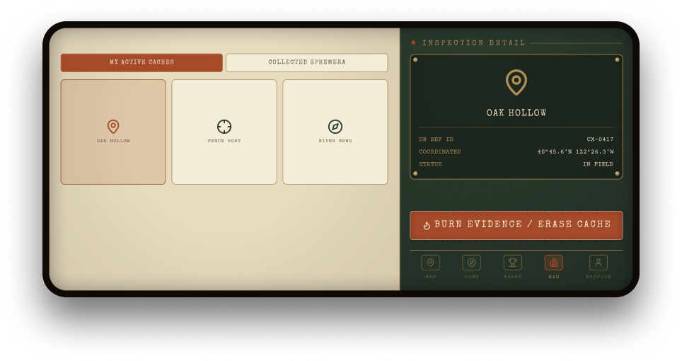
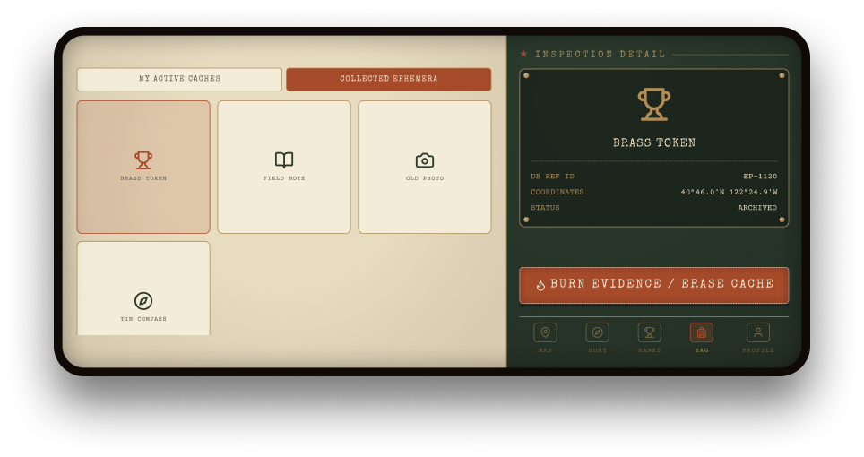
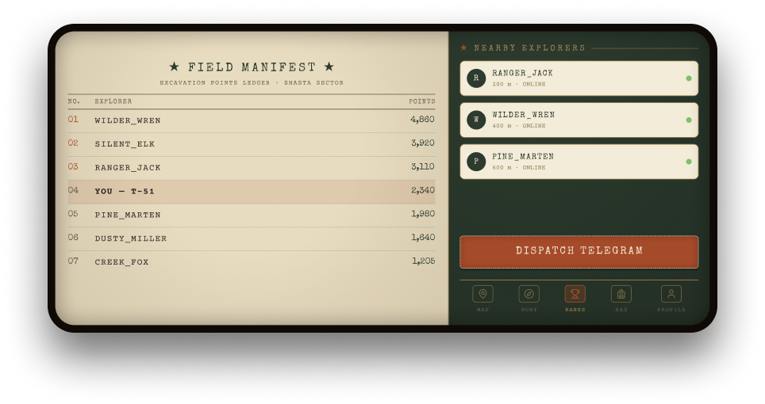
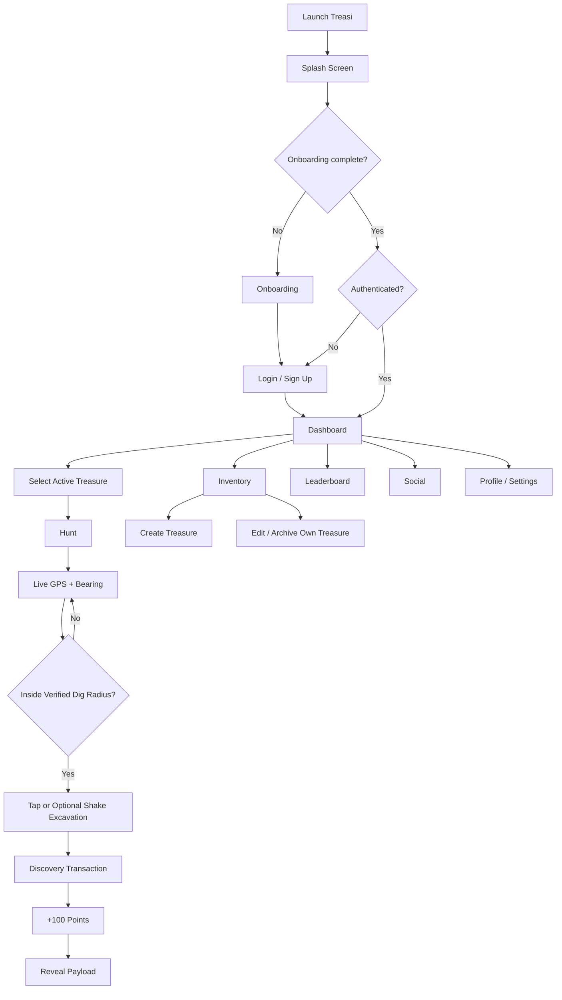
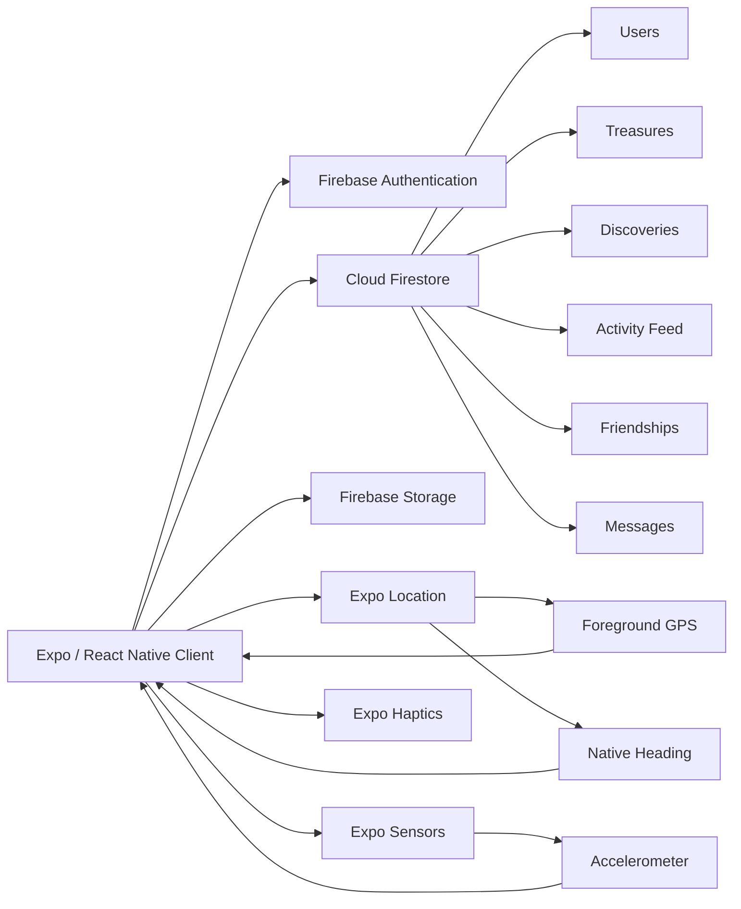

# Treasi

<p align="center">
  
</p>

<p align="center">
  <strong>Hide. Explore. Stay connected.</strong>
</p>

<p align="center">
  A landscape-first, sensor-driven scavenger-hunt application built with React Native, Expo SDK 58 and Firebase.
</p>

<p align="center">
  <a href="https://github.com/AngievR05/treasi"><strong>GitHub Repository</strong></a>
  &nbsp;•&nbsp;
  <a href="https://drive.google.com/drive/folders/1_r2pFbygXuqpii-kw80xBZH0yWf4nzcy?usp=sharing"><strong>Watch the Treasi demo video</strong></a>
</p>

---

## Table of Contents

- [Project Overview](#project-overview)
- [Project Brief](#project-brief)
- [Problem and Concept](#problem-and-concept)
- [Core Experience](#core-experience)
- [Wireframes](#wireframes)
- [Key Features](#key-features)
- [User Flow](#user-flow)
- [Technology Stack](#technology-stack)
- [Application Architecture](#application-architecture)
- [Firebase Data Model](#firebase-data-model)
- [CRUD Operations](#crud-operations)
- [Location, Compass and Sensor Behaviour](#location-compass-and-sensor-behaviour)
- [60/40 Landscape Interface](#6040-landscape-interface)
- [Accessibility](#accessibility)
- [Design System](#design-system)
- [Project Structure](#project-structure)
- [Prerequisites](#prerequisites)
- [Environment Configuration](#environment-configuration)
- [Installation](#installation)
- [Running Treasi](#running-treasi)
- [How to Use Treasi](#how-to-use-treasi)
- [Firebase Setup](#firebase-setup)
- [Platform Behaviour](#platform-behaviour)
- [Known Limitations](#known-limitations)
- [Future Improvements](#future-improvements)
- [Demo Video](#demo-video)
- [Project Information](#project-information)
- [Acknowledgements](#acknowledgements)
- [Licence](#licence)

---

## Project Overview

**Treasi** is an asynchronous, location-based scavenger-hunt application that turns a mobile device into a digital field instrument.

Explorers can hide digital treasure caches at real-world coordinates, discover caches created by other users, navigate towards a selected target using live location and compass information, and unlock the hidden payload when they physically reach the cache area.

The application combines:

- Firebase Authentication
- Cloud Firestore
- Foreground GPS location
- Native compass heading
- Accelerometer input
- Haptic feedback
- Native and web map implementations
- Real-time activity data
- Social and leaderboard features
- A landscape-first 60/40 interface

Treasi is designed for **Expo SDK 58** and targets **iPhone, Android and Expo Web**.

---

## Project Brief

Treasi was developed for:

**Interactive Development 300 (DV300) — Semester 2, Theme 3**

The project is based on three central constraints:

| Requirement | Treasi response |
| --- | --- |
| **Goal theme** | Stay Connected |
| **Device interaction** | Device sensors |
| **Interface constraint** | Landscape support |

Landscape orientation is treated as a design opportunity rather than a restriction. The phone becomes a wide field console inspired by analogue navigation instruments, archival field equipment and mechanical dashboards.

---

## Problem and Concept

Modern communication platforms make staying in contact easy, but much of that interaction remains passive and screen-centred. Treasi explores a different type of digital connection by connecting messages, rewards and social interactions to physical places.

Instead of only sending a conventional message, an explorer can hide a digital cache at a real-world location. Another explorer can encounter that cache while moving through a campus, neighbourhood or shared public environment.

The resulting interaction is:

- **Physical** — discovery requires movement through real space.
- **Asynchronous** — explorers do not need to be online together.
- **Location-based** — caches belong to coordinates rather than a conventional feed.
- **Playful** — navigation, clues and excavation create a game loop.
- **Social** — discoveries, rankings, friendships and messages connect explorers.

The core loop is:

> **Hide → Navigate → Locate → Excavate → Discover → Connect**

---

## Core Experience

### Hide

An explorer creates a treasure cache containing a title, clue, hidden payload and geographic position. The cache is stored in Cloud Firestore and becomes visible to other explorers while active.

### Navigate

The Dashboard displays the field map and active treasures. Selecting a cache creates a Hunt target.

### Hunt

The Hunt screen follows the Explorer's foreground position and calculates the real geographic distance and bearing to the target.

On native devices, Treasi uses native heading information for the compass. The interface also reports location readiness and accuracy so it does not pretend a position is sufficiently precise when it is not.

### Excavate

A discovery can only be submitted when Treasi has a fresh live position and the Explorer is within the configured target radius.

The on-screen excavation control is always available when the target has been verified. Accelerometer-based shake excavation is an optional secondary interaction on supported devices.

### Discover

After a successful discovery:

1. A discovery record is created.
2. The Explorer receives points.
3. A field activity event is created.
4. The hidden payload is revealed.
5. Haptic feedback is used when enabled and supported.

---

## Wireframes

The final project keeps the visual language established during Treasi's wireframing phase. The reference images are stored in `app/assets/Wireframes/` and are included below so the design progression is visible directly from the repository.

### Splash Screen

<p align="center">
  
</p>

### Authentication

<p align="center">
  
</p>

### Dashboard

<p align="center">
  
</p>

### Hunt

<p align="center">
  
</p>

### Inventory

<table>
  <tr>
    <td align="center" width="50%">
      
      <br />
      <strong>Inventory</strong>
    </td>
    <td align="center" width="50%">
      
      <br />
      <strong>Inventory alternate state</strong>
    </td>
  </tr>
</table>

### Leaderboard

<p align="center">
  
</p>

### Profile

<p align="center">
  
</p>

---

## Key Features

### Authentication

Treasi uses Firebase Authentication with email and password credentials.

Users can:

- Register an Explorer account.
- Sign in with email and password.
- Restore an authenticated Firebase session after restarting the application.
- Request a password-reset email.
- Request email verification.
- Sign out safely.

Login verifies that the authenticated Explorer has a corresponding Firestore profile. Existing profiles are read without resetting saved preferences or points.

### Onboarding

The onboarding flow introduces the core field interactions:

1. **Align Instrument** — explains the landscape-first experience.
2. **Track Targets** — introduces location and navigation behaviour.
3. **Excavate Rewards** — explains target discovery and physical interaction.

Onboarding completion is stored locally with AsyncStorage and synchronised with the signed-in Explorer profile when available.

The Profile and Settings screen also allows the onboarding guide to be reviewed later without resetting completion state.

### Dashboard and Field Map

The Dashboard acts as the main operational view and includes:

- Active treasure markers.
- Explorer location when available.
- Nearby-cache filtering when a real position is available.
- Treasure selection.
- Real-time field activity.
- Navigation to Hunt, Inventory, Ranks and Profile.
- Location recovery controls.
- Cache creation access.

Native devices use `react-native-maps`. Web uses a dedicated `FieldMap.web.tsx` implementation with Leaflet and OpenStreetMap tiles.

### Treasure Creation and Inventory

The Inventory screen manages active caches and the Explorer's own planted caches.

Treasure records support:

- Creation.
- Reading and synchronisation.
- Editing by the creator.
- Archiving by the creator.
- Permanent deletion where the deployed Firestore rules permit it.

A treasure can contain:

```text
treasureId
creatorId
creatorName
title
hint
payloadText
imageUrl
location
isArchived
createdAt
updatedAt
```

`location` is stored as a Firestore `GeoPoint`.

### Hunt

The Hunt experience includes:

- Live foreground GPS tracking.
- Cached-position display while waiting for a live fix.
- Fresh-location validation before excavation.
- Horizontal accuracy checks.
- Five-metre discovery radius.
- Native compass heading on supported iOS/Android devices.
- True-north heading where available, with magnetic-north fallback.
- Numerical bearing fallback.
- Android simulated-location rejection for discovery verification.
- iOS/Android precise-location checks where exposed by the platform.
- Optional accelerometer-based shake excavation.
- Tap-to-excavate accessibility fallback.
- Optional haptic success feedback.
- Hidden payload reveal.
- Atomic Firestore discovery and point updates.

### Leaderboard

The Leaderboard provides a ranked Explorer view based on `totalPoints` and highlights the active Explorer where applicable.

Treasi's current rank progression is:

| Points | Rank |
| ---: | --- |
| 0–499 | Novice Scout I |
| 500–1,499 | Pathfinder II |
| 1,500–2,999 | Trailblazer III |
| 3,000+ | Master Explorer |

### Social

Treasi includes social functionality for asynchronous Explorer interaction, including friendship records and field messages.

Friendship states include:

```text
pending
accepted
declined
blocked
```

### Activity Feed

Field events are stored in `activity_feed` and can include events such as:

```text
TREASURE_HIDDEN
TREASURE_FOUND
TREASURE_ARCHIVED
TELEGRAM_DISPATCH
FRIEND_REQUEST
FRIEND_ACCEPTED
PROFILE_UPDATED
```

### Profile and Settings

The Profile and Settings screen uses the reversed 60/40 arrangement requested for account management:

- **Left 60%** — settings and account controls.
- **Right 40%** — Explorer identity and account information.

Controls include:

- Haptic feedback.
- Shake sensitivity.
- Location-sharing preference.
- Battery-saving preference.
- Night-field preference.
- System Reduce Motion status.
- Clear stored shared location.
- Review onboarding.
- Open system permissions/settings.
- Refresh Firebase profile state.
- Email verification.
- Password reset.
- Callsign editing.
- Restore default preferences.
- Sign out.
- Guarded account-deletion interface.

Secure permanent account deletion requires trusted server-side cleanup before it can safely remove Firebase Authentication and associated account data together.

---

## User Flow



---

## Technology Stack

### Application

| Technology | Purpose |
| --- | --- |
| React 19.3 | Component model |
| React Native 0.88 | Cross-platform native UI |
| TypeScript 6.0 | Type-safe application development |
| Expo SDK 58 | Native development platform and runtime |
| React Native Web | Browser support |
| React Native Maps | Native field-map rendering |
| React Native SVG | Custom instrument graphics |
| Expo Location | Foreground location and native heading APIs |
| Expo Sensors | Accelerometer interaction |
| Expo Haptics | Native haptic feedback |
| Expo Screen Orientation | Landscape orientation control |
| AsyncStorage | Local onboarding state |
| Expo Image Picker | Image-selection capability |
| Expo Vector Icons | Cross-platform iconography |

### Backend

| Technology | Purpose |
| --- | --- |
| Firebase Authentication | Explorer registration and authentication |
| Cloud Firestore | Remote application database and real-time listeners |
| Firebase Storage | Remote media storage configuration |
| Firebase JS SDK | Cross-platform Firebase client integration |

### Development

| Technology | Purpose |
| --- | --- |
| Node.js | JavaScript development runtime |
| npm | Dependency and script management |
| Git | Version control |
| Expo CLI | Development server and platform launch commands |

> React Navigation packages are installed in the project, but the current primary screen flow is coordinated from `App.tsx` using the Treasi screen-state navigation layer and `FieldNavBar`.

---

## Application Architecture

Treasi follows a client + Backend-as-a-Service architecture.



There is no separate Express or Node API server in the current implementation. Firebase provides authentication, storage and database services directly to the client, protected by Firebase security rules.

---

## Firebase Data Model

### `users`

Stores an authenticated Explorer profile and persistent preferences.

```text
uid
username
email
totalPoints
hasCompletedOnboarding
telemetryEnabled
hapticFeedbackEnabled
motionSensitivityEnabled
batteryOptimizerEnabled
nightModeEnabled
skipOnboardingAuthFlow
location?                  // optional shared GeoPoint
createdAt
updatedAt
```

`skipOnboardingAuthFlow` remains in the current schema for compatibility with older project code, but it is not presented as a user-facing bypass in the production settings interface.

### `treasures`

Stores field caches.

```text
treasureId
creatorId
creatorName
title
hint
payloadText
imageUrl?
location                   // Firestore GeoPoint
isArchived
createdAt
updatedAt?
```

### `discoveries`

Tracks successful treasure excavations.

```text
discoveryId
treasureId
hunterId
unlockedAt
```

The current discovery identifier follows:

```text
{hunterId}_{treasureId}
```

This lets the application prevent duplicate credit for the same Explorer and treasure.

### `activity_feed`

Stores real-time field events.

```text
activityId?
userId
username
type
message
targetId
createdAt
```

### `friendships`

Stores Explorer relationships and requests.

Typical fields include:

```text
friendshipId
requesterId
receiverId
status
createdAt
updatedAt
```

### `messages`

Stores short social/field messages used by the Social experience.

---

## CRUD Operations

Treasi demonstrates remote CRUD behaviour through Cloud Firestore.

| Operation | Examples in Treasi |
| --- | --- |
| **Create** | Register user profile, create treasure, create discovery, send message, create friendship request, write activity event |
| **Read** | Stream treasures, read user profile, load leaderboard, read discoveries, read activity, social data |
| **Update** | Edit treasure data, archive cache, change profile preferences, edit callsign, accept friendship state |
| **Delete** | Delete permitted treasure/social records according to ownership and deployed Firestore rules |

Archive behaviour is a soft-delete pattern:

```text
isArchived = true
```

An archived treasure is hidden from active hunting and can no longer award a new discovery.

---

## Location, Compass and Sensor Behaviour

### Foreground GPS

Treasi uses `expo-location` for foreground location only.

The application can:

- Check existing foreground permission without immediately showing a system prompt.
- Request permission after an explicit user action where required.
- Check whether device location services are enabled.
- Use a recent cached position for temporary orientation.
- Watch live foreground positions.
- Request a fresh high-accuracy fix.
- Report horizontal accuracy.
- Pause foreground location subscriptions when Hunt is inactive/backgrounded.

A cached position can help orient the interface, but it **cannot** unlock a treasure.

### Discovery Verification

The Hunt interface requires:

- An authenticated Explorer.
- A real treasure target.
- A valid treasure location.
- A fresh live position.
- Acceptable horizontal accuracy.
- A position inside the configured five-metre target radius.
- A treasure not created by the active Explorer.
- A treasure that is not archived.
- No previous discovery record for the same Explorer and treasure.

On Android, a location reported as simulated/mocked is rejected for excavation verification.

### Compass

On native iOS and Android, Treasi uses Expo Location heading data rather than manually converting raw magnetometer axes.

The Hunt compass:

- Uses true heading when available.
- Falls back to magnetic heading.
- Rotates the instrument card relative to the device heading.
- Points the target needle towards the geographic bearing of the treasure.
- Shows numerical bearing as a fallback.
- Reports calibration quality when the platform supplies it.

Web does not pretend to provide reliable native compass hardware; it retains numerical location/bearing guidance instead.

### Accelerometer

The accelerometer supports optional shake excavation on devices that provide motion sensor access.

Treasi measures acceleration away from the normal gravity baseline to reduce accidental activations from ordinary movement.

The primary tap-to-excavate control remains available so the Hunt is not dependent on a shake gesture.

### Haptics

Successful excavation can trigger native haptic feedback when:

- The device supports haptics.
- The current platform is native.
- Haptic feedback is enabled in the Explorer profile.

---

## 60/40 Landscape Interface

The application uses a consistent landscape split inspired by physical field equipment.

```text
┌──────────────────────────────────────────────────────────────┐
│                                                              │
│              PRIMARY 60%              SECONDARY 40%          │
│                                                              │
│       map / instrument / settings       controls / data      │
│       primary operational context       supporting actions   │
│                                                              │
└──────────────────────────────────────────────────────────────┘
```

The exact content changes by screen:

| Screen | 60% area | 40% area |
| --- | --- | --- |
| Dashboard | Map / field context | Activity and controls |
| Hunt | Navigation instrument | Clue and excavation console |
| Inventory | Main cache-management content | Supporting controls/details |
| Leaderboard | Rankings | Supporting Explorer/community information |
| Social | Main social content | Supporting field controls |
| Profile | **Settings** | **Explorer profile information** |

The Profile screen deliberately reverses the usual information priority so settings occupy the larger left section.

---

## Accessibility

Accessibility is treated as part of the production UI rather than a separate visual mode.

### Touch Targets

Important controls are designed around a minimum target of approximately **48 × 48 dp**.

### Screen Readers

The application uses accessibility roles, labels, hints, states and live-region announcements for important actions and changing telemetry.

Decorative visual elements are removed from the accessibility tree where appropriate.

### Reduce Motion

Treasi reads the operating system's Reduce Motion setting and removes or reduces non-essential screen/compass transitions where appropriate.

### Alternatives to Motion Gestures

Shake excavation is optional. A standard on-screen control provides the same core action.

### Colour and Status

Important states are not communicated using colour alone. Labels, icons, borders and status text reinforce changes such as:

- Live GPS readiness.
- Poor accuracy.
- Permission errors.
- Archived caches.
- Active navigation tabs.
- Successful excavation.

### Responsive Text and Layout

Screens use flex-based layout, dynamic dimensions and font scaling limits to remain usable across different landscape aspect ratios.

---

## Design System

Treasi uses a vintage field-instrument identity inspired by:

- National park ranger equipment.
- Surveying instruments.
- Mechanical dashboards.
- Archival field notes.
- Weathered maps.
- Brass fittings.
- Typewriter interfaces.

### Core Palette

| Token | Example | Purpose |
| --- | --- | --- |
| Forest | `#2C3B2E` | Main field chassis/background |
| Deep Forest | `#172018` / `#1C261D` | High-contrast instrument areas |
| Parchment | `#E8DCC0` / `#F6EFD9` | Light cards and paper surfaces |
| Rust / Sienna | `#7F321B` / `#8A3D24` | Primary actions and alerts |
| Brass | `#B08D57` / `#C3A06A` | Borders, hardware and secondary emphasis |
| Ink | `#2A2420` | Primary text on parchment |

### Typography

The implemented interface uses a monospaced/Courier-style field-instrument treatment across platforms, with platform fallbacks where a custom font is not available.

### Visual Principles

- Strong horizontal composition.
- Parchment versus dark-instrument contrast.
- Mechanical borders and rails.
- Analogue-style telemetry.
- Restrained animation.
- Clear operational state labels.
- Field terminology instead of generic dashboard language.

---

## Project Structure

```text
treasi/
├── .vscode/
├── README.md
│
└── app/
    ├── assets/
    │   ├── Wireframes/
    │   │   ├── Auth Screen.png
    │   │   ├── Cover.png
    │   │   ├── Dashboard Screen.png
    │   │   ├── Hunt Screen.png
    │   │   ├── Inventory-1.png
    │   │   ├── Inventory.png
    │   │   ├── Leaderboard.png
    │   │   ├── Profile.png
    │   │   └── Splash Screen.png
    │   └── Logo.svg
    │
    ├── src/
    │   ├── components/
    │   │   ├── FieldMap.native.tsx
    │   │   ├── FieldMap.types.ts
    │   │   ├── FieldMap.web.tsx
    │   │   ├── FieldNavBar.tsx
    │   │   └── LandscapeSplitLayout.tsx
    │   │
    │   ├── config/
    │   │   ├── firebase.d.ts
    │   │   ├── firebase.native.ts
    │   │   ├── firebase.options.ts
    │   │   ├── firebase.ts
    │   │   └── firebase.web.ts
    │   │
    │   ├── hooks/
    │   │   ├── useAuth.ts
    │   │   └── useLandscapeOrientation.ts
    │   │
    │   ├── navigation/
    │   │   └── RootNavigator.tsx
    │   │
    │   ├── screens/
    │   │   ├── Auth/
    │   │   │   ├── LoginScreen.tsx
    │   │   │   └── SignUpScreen.tsx
    │   │   ├── DashboardScreen.tsx
    │   │   ├── HuntScreen.tsx
    │   │   ├── InventoryScreen.tsx
    │   │   ├── LeaderboardScreen.tsx
    │   │   ├── OnboardingScreen.tsx
    │   │   ├── ProfileSettingsScreen.tsx
    │   │   ├── SocialScreen.tsx
    │   │   └── SplashScreen.tsx
    │   │
    │   └── types/
    │       ├── firebase-auth-react-native.d.ts
    │       ├── firestore.ts
    │       ├── navigation.ts
    │       └── svg.d.ts
    │
    ├── App.tsx
    ├── DemoVideo.txt
    ├── app.json
    ├── babel.config.js
    ├── index.ts
    ├── metro.config.js
    ├── package.json
    ├── package-lock.json
    └── tsconfig.json
```

> `node_modules/`, `.expo/` and local environment secrets should not be committed to the repository.

---

## Prerequisites

Before running Treasi, install or configure:

- **Node.js 24.3+** (Node 24 LTS recommended) and npm.
- A Firebase project.
- Expo-compatible development tooling.
- A modern browser for the web version.
- Android Studio/emulator or a physical Android device for Android testing.
- An iOS simulator on macOS or a signed development build for physical iPhone testing.

A **physical device is strongly recommended** for testing Hunt because GPS, compass, accelerometer and haptic behaviour cannot be fully reproduced by a desktop browser.

---

## Environment Configuration

Treasi loads Firebase client configuration through Expo public environment variables.

Create a `.env` file in the project root:

```env
EXPO_PUBLIC_FIREBASE_API_KEY=your_api_key
EXPO_PUBLIC_FIREBASE_AUTH_DOMAIN=your_auth_domain
EXPO_PUBLIC_FIREBASE_PROJECT_ID=your_project_id
EXPO_PUBLIC_FIREBASE_STORAGE_BUCKET=your_storage_bucket
EXPO_PUBLIC_FIREBASE_MESSAGING_SENDER_ID=your_sender_id
EXPO_PUBLIC_FIREBASE_APP_ID=your_app_id
EXPO_PUBLIC_FIREBASE_MEASUREMENT_ID=your_measurement_id
```

Do not commit environment-specific `.env` files containing project configuration that should remain local to the development environment.

Firebase client configuration does not replace security rules. Firestore and Storage access must still be protected by deployed Firebase rules.

---

## Installation

### 1. Clone the repository

```bash
git clone https://github.com/AngievR05/treasi.git
cd treasi/app
```

### 2. Install dependencies

```bash
npm install
```

### 3. Align Expo dependencies

For Expo SDK 58, Expo's installer should be used when correcting native package versions:

```bash
npx expo install --fix
```

### 4. Check the project

```bash
npx expo-doctor
```

### 5. Configure Firebase

Create the `.env` file described above and make sure Authentication, Firestore and any required Storage configuration are available.

---

## Running Treasi

### Standard Expo development server

```bash
npx expo start --clear
```

### Web

```bash
npm run web
```

or:

```bash
npx expo start --web
```

The development URL is normally available through localhost.

### Android

```bash
npm run android
```

or start Expo and press `a`:

```bash
npx expo start --clear
```

For a physical device on a network that blocks normal LAN discovery, a tunnel can be used:

```bash
npx expo start --tunnel --clear
```

### iOS

```bash
npm run ios
```

After an SDK upgrade, rebuild existing **Expo development builds** before using them. Expo Go must also support SDK 58.

A development-client workflow can be started with:

```bash
npx expo start --dev-client --tunnel --clear
```

A signed iOS development build requires the appropriate Apple development credentials.

---

## How to Use Treasi

### First Launch

1. Open Treasi in landscape orientation.
2. Complete the Splash diagnostics.
3. Complete the onboarding guide.
4. Create an Explorer account or sign in.
5. Enter the Dashboard.
6. Enable foreground location when you are ready to use location-based features.

### Create a Treasure

1. Open **Bag / Inventory**.
2. Choose the cache-creation action.
3. Use a valid current location or approved coordinates.
4. Enter the cache title.
5. Enter a clue.
6. Enter the hidden payload.
7. Save the cache.
8. Treasi writes the treasure to Firestore.
9. A field activity event is created where supported by the current workflow.

### Hunt a Treasure

1. Select an active treasure from the Dashboard or Inventory.
2. Enter **Hunt**.
3. Allow foreground location if it has not already been granted.
4. Follow the distance and target bearing.
5. If the compass is available, orient using the live field instrument.
6. Move towards the cache until the Hunt reports a verified dig site.
7. Tap the excavation control, or use the optional shake interaction if enabled.
8. Treasi verifies the latest position again before submitting.
9. The discovery is recorded atomically in Firestore.
10. The hidden payload is revealed and points are awarded.

### Manage a Treasure

For a treasure you created, the Inventory can expose the permitted management actions, such as:

- Edit metadata.
- Archive the cache.
- Restore supported editable information.
- Delete the record where the deployed rules and current feature permit it.

### Profile and Settings

Open **Profile** from the FieldNavBar to manage:

- Explorer callsign.
- Feedback and motion preferences.
- Location sharing.
- Display/power preferences.
- Onboarding review.
- System permissions.
- Email security actions.
- Sign out.

---

## Firebase Setup

### 1. Create a Firebase Project

Create the Treasi Firebase project in the Firebase Console.

### 2. Enable Authentication

Enable:

```text
Authentication
└── Sign-in method
    └── Email/Password
```

### 3. Create Cloud Firestore

Treasi currently uses collections including:

```text
users
treasures
discoveries
activity_feed
friendships
messages
```

Other supporting collections may be present depending on the final Social/Inventory implementation.

### 4. Configure Firebase Storage

Firebase Storage is configured in the project for remote media support. Image upload/use should follow the final Storage rules and project requirements.

### 5. Deploy Firestore Rules

The application relies on Firestore rules to prevent unauthorised writes.

Rules should enforce, at minimum:

- Authenticated access where required.
- Ownership checks for creator-controlled treasure operations.
- Protection of another Explorer's private/account-controlled data.
- Valid discovery ownership.
- Valid friendship participants.
- Valid message/activity writers.

Client-side checks improve the interface but are **not a replacement for Firebase rules**.

---

## Platform Behaviour

### iPhone / iOS

- Landscape-first UI.
- Foreground location permission.
- Precise/reduced location awareness where exposed by Expo Location.
- Native heading support.
- Accelerometer support where available and permitted.
- Haptic feedback where supported.
- Safe-area-aware layouts.

### Android

- Landscape-first UI.
- Fine/coarse foreground location awareness.
- Location provider recovery controls.
- Native heading support.
- Android simulated-location rejection in Hunt verification.
- Accelerometer support where available and permitted.
- Haptic feedback where supported.

### Web

- Runs through Expo Web on localhost.
- Uses the dedicated Leaflet/OpenStreetMap field-map implementation.
- Uses browser geolocation where available.
- Does not pretend to provide the same native compass behaviour as iOS/Android.
- Sensor-driven interactions degrade to accessible controls.

---

## Known Limitations

### GPS Precision

Consumer GPS accuracy varies with hardware, buildings, weather, network availability and sky visibility. Treasi therefore cannot guarantee that every device will immediately achieve the accuracy required for a five-metre excavation radius.

### Client-Side Geographic Verification

The current Hunt verifies location in the client before committing the discovery transaction. The Firestore transaction protects duplicate discoveries and point updates, but a deliberately modified client could attempt to bypass client-side geographic checks.

A stronger anti-cheat production architecture would verify discovery coordinates in trusted server-side logic.

### Compass Calibration

Heading quality depends on physical device sensors and calibration. Treasi displays bearing information even when the native compass is unavailable or poorly calibrated.

### Web Sensors

The web version cannot provide the full native sensor experience consistently across browsers. Web is supported as a development/runtime target, while the intended field experience is strongest on a physical iOS or Android device.

### Account Deletion

The Profile screen includes a guarded Delete Account interface, but secure permanent deletion should only be enabled once a trusted server-side process can remove Firebase Authentication and related personal account data together. Treasi deliberately avoids partial deletion that could leave account data behind.

### Location Sharing

Exact profile location should only be written when the Explorer explicitly enables the relevant location-sharing preference. Core Hunt location should remain foreground-only and does not require silently publishing the Explorer's location to other users.

### Geospatial Scale

The current treasure model stores a Firestore `GeoPoint` but does not yet use a geohash-backed server-side radius query. Large treasure datasets would require a more scalable geospatial-query strategy.

### Development Dependencies

The project currently contains some dependencies and legacy navigation/configuration files that are not central to the final screen-state navigation flow. They can be removed during a final dependency-clean-up pass once all native builds are confirmed.

---

## Future Improvements

Potential future work includes:

1. Trusted server-side discovery verification.
2. Geohash-backed nearby treasure queries.
3. Full Firebase Storage image upload during cache creation.
4. Secure server-side account deletion.
5. Richer achievement and badge progression.
6. More detailed Explorer statistics.
7. Offline-friendly cached field data.
8. Richer Telegram/message inbox behaviour.
9. Improved compass calibration guidance.
10. Expanded privacy controls for social location sharing.
11. Automated Firestore security-rule tests.
12. Automated unit/integration tests for distance, bearing and navigation logic.
13. Formal EAS Android/iOS development and release profiles.
14. Removal of unused legacy dependencies and navigation files.
15. Production geospatial monitoring and performance profiling.

---

## Demo Video

The Treasi demonstration video is available in the linked Google Drive folder:

### [▶ Watch the Treasi Demo Video](https://drive.google.com/drive/folders/1_r2pFbygXuqpii-kw80xBZH0yWf4nzcy?usp=sharing)

The demonstration should show the main user journey, including authentication, the field dashboard, cache interaction, Hunt/location behaviour, Inventory, Leaderboard/Social functionality and Profile settings.

---

## Project Information

**Project:** Treasi  
**Repository:** https://github.com/AngievR05/treasi  
**Tagline:** Hide. Explore. Stay connected.  
**Student:** Angie van Rooyen  
**Student Number:** 241077  
**Institution:** Open Window  
**Course:** Interactive Development 300 (DV300)  
**Term:** Semester 2 — Theme 3  
**Primary Framework:** React Native + Expo SDK 58<br />
**Backend:** Firebase

---

## Acknowledgements

Treasi was developed using technologies and libraries including:

- React
- React Native
- Expo
- TypeScript
- Firebase Authentication
- Cloud Firestore
- Firebase Storage
- React Native Maps
- React Native SVG
- Expo Location
- Expo Sensors
- Expo Haptics
- Expo Screen Orientation
- Expo Vector Icons
- AsyncStorage
- React Native Web

The project's visual and interaction language draws inspiration from analogue navigation equipment, national park field guides, surveying tools, archival maps, mechanical dashboards and typewriter interfaces.

Third-party frameworks and libraries remain subject to their respective licences.

---

## Licence

Treasi was created as an academic submission for Open Window's Interactive Development 300 course.

Unless otherwise stated, the original Treasi application code, visual design and project-specific assets are academic work belonging to the project author.

Third-party libraries, frameworks, services and assets remain subject to their respective licences and terms.

---

## Project Statement

> **Treasi transforms everyday physical routes into interactive grounds for discovery and connection. By combining a landscape-first interface, live location, directional navigation, optional motion interaction and Firebase-powered social data, Treasi turns a smartphone from a passive communication device into a tactile field instrument.**

<p align="center">
  <strong>Treasi — Hide. Explore. Stay connected.</strong>
</p>
